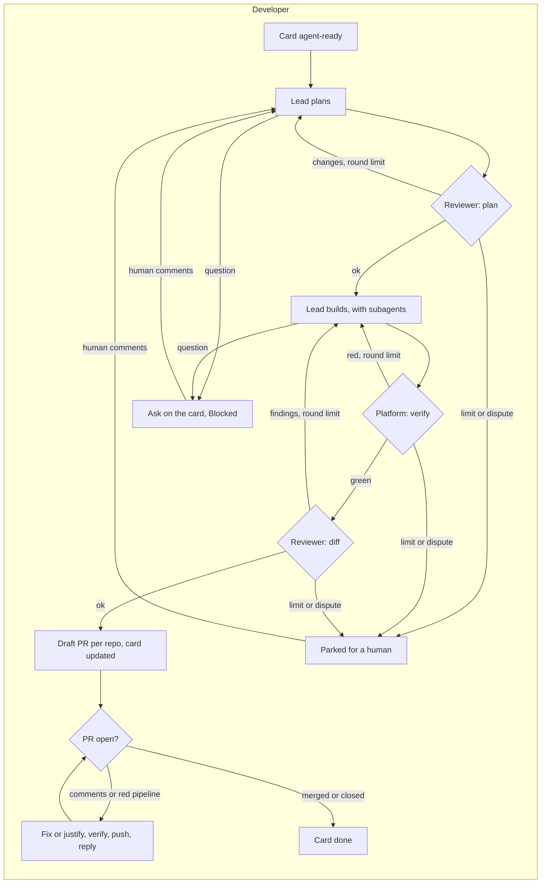

# agentCowork

[](https://github.com/lucianoscastro/agent-cowork/actions/workflows/docker.yml)
[](https://github.com/lucianoscastro/agent-cowork/actions/workflows/cve.yml)
[](https://hub.docker.com/r/lucianoscastro/agent-cowork)
[](https://hub.docker.com/r/lucianoscastro/agent-cowork)

A self-hosted control plane that runs a small team of AI coding agents for a software company, on its GitHub and Jira:

| Agent | What it does |
| --- | --- |
| **Developer** | Picks agent-ready Jira cards and plans the work with a lead runtime (Claude Code by default). Up to **two independent reviewers** (each switchable; by default one, on Codex) check the plan in parallel, and each must approve. The lead builds it, with optional coder and tester subagents on their own models. The platform then runs install, build and tests, the reviewers audit the diff, and the agent opens one PR per changed repository. A card that needs no code ends another way: the platform opens **promotion PRs** between existing branches (e.g. `develop` → `qa`), posts the **answer** to a question, or hands a **checklist** to a person for what agents cannot access. It then **follows each PR until it is closed**: it answers every review comment (fixing it, or declining it with a justification) and keeps the pipeline green, including quality gates such as SonarQube. Merging stays with humans. |
| **Dependabot** | Assesses Dependabot PRs. Patch and minor updates that pass every gate (release cooldown, green CI, the repository's verify commands, a low-cost model's risk check) are approved and merged. Everything else goes to a human. |
| **Approver** | Reviews PRs that request review **directly** from the configured GitHub user. Approves when there is nothing to suggest; otherwise comments inline. |
| **Auditor** | Audits every project repository in the categories you enable: **security**, **privacy (LGPD)**, **performance**, **reliability**, **test gaps**, **code health**, **dependencies** and **accessibility**. Each category has its own skill, model and interval, and runs only when the base branch moved. The Findings page shows each repository's history per category (new, still open and fixed findings) and turns a finding into a Jira card; critical and high findings go to the Inbox. Read-only on the code. |
| **Sentinel** | QA for each project's test environment. It finds the project's end-to-end suite on its own (Playwright, Cucumber or Cypress, from the repository's files), runs it once a day against the environment with a report format of its own choosing, runs each failed test again alone to rule out flakiness, reproduces the ones that keep failing in a real browser, and files the real bugs on the project's board with screenshots, the HAR and the steps (or comments on the open bug). Every few hours it also explores what changed in the repositories marked for it and sends what it confirms to the inbox, where a person turns it into a card. Setup is two checks, a URL and a branch per repository, plus one JSON of test variables per repository: the suite is found again on every run. |
| **Documenter** | Keeps a living map of each repository in a docs folder (`.agents` by default): architecture, modules, data model, entry points, security, state machines, critical flows, technical debt and one file per business domain, with Mermaid diagrams and a `file:line` reference for every rule. The first run writes it all; every few days it updates what new commits touched. It writes only in that folder and opens one PR per repository, updating it while it is open. |

Agents run on **Claude Code**, **Codex** or **Antigravity (`agy`)**, each authenticated with an **API key or an account login**. Everything is configured in an admin UI. Run one container per company, with nothing shared between them.

> Start with **dry run** on (the default). Agents then do all the work (models, verification) but write nothing to GitHub or Jira, so you can compare their judgment with yours first.

## How it works



Each project also has a **brain**: an Obsidian-compatible vault of lessons the agents learned (environments, databases, conventions, decisions). Every run reads it first; runs where people answered or reviewed, or a finding or failing build was fixed, add to it.

| Principle | How it is enforced |
| --- | --- |
| Gates, not trust | The platform runs verification itself. An independent reviewer checks plans and diffs, and the lead cannot dismiss it: disagreements park the run for a human. Every loop has a round limit. |
| Edges as code | Runtimes get an allow-listed environment with **only their own credential**: never the GitHub or Jira tokens, which only the orchestrator holds. Reviews run read-only. Repository hooks and MCP configs are ignored. |
| Humans own decisions | The developer agent never merges. Questions go to the card in one batch, and the agent resumes when someone answers. |
| Isolation | One container per company, one worktree per run. Read-only root filesystem, no Linux capabilities, `no-new-privileges`, non-root user. |
| Kill switch | Any run, or all runs of an agent, can be stopped from the UI. Every action is in the audit log. |

## Quick start

```bash
cp compose.example.yaml compose.yaml           # one service per company
cp env/example.env env/company-a.env           # bootstrap: admin user and secret key
openssl rand -base64 32                        # paste as AGENTCOWORK_SECRET_KEY
docker compose up -d --build company-a
```

Open <http://localhost:8081>, sign in with the admin user from the env file, then:

Home shows a setup checklist until these are done:

1. **Setup → Accounts:** store the GitHub token of the user the agents act as; for the developer agent, also the Jira site, email and API token. Then pick API key or account login for each agent runtime and connect it.
2. **Setup → Projects** (developer and Dependabot): the Jira board (developer), the repositories (each checked out in a folder named after it), and each repository's stack (Node.js, React or .NET). The stack picks the verify commands set under Setup → General; a repository can replace them with its own.
3. **Team → each agent → Settings:** enable it, and pick runtimes, models, triggers and limits.
4. Watch **Work → Runs** in dry run. When you trust an agent's results, turn its dry run off in its Settings, one agent at a time.

Only bootstrap settings live in the env file. Everything else is stored in the database, with secrets encrypted.

## Credentials

| Where | What | How to get it |
| --- | --- | --- |
| Integrations → GitHub | Token of the user the agents act as | A classic PAT with `repo` and `read:org` (authorized for SSO if needed), or `gh auth token` |
| Integrations → Jira | Site, email, **classic** API token | <https://id.atlassian.com/manage-profile/security/api-tokens>. Do not create a token "with scopes". |
| Providers → Claude Code | API key, **or** account login | Account: the UI runs `claude setup-token`. Open the link, sign in, and paste the code back. |
| Providers → Codex | API key, **or** account login | Account: the UI runs the device flow. Open the link and enter the code shown. |
| Providers → Antigravity | Gemini API key, **or** account login (experimental) | Account login is for **business** Google accounts only: Google's terms do not allow personal accounts in tools like this. After opening the link you have 60 s to paste the code. See [docs/spikes/agy.md](docs/spikes/agy.md). |

## Bootstrap environment (`env/<instance>.env`)

| Variable | Description |
| --- | --- |
| `INSTANCE_NAME` | Shown in the UI and logs. |
| `ADMIN_USERNAME`, `ADMIN_PASSWORD` | The single admin user of the UI. |
| `AGENTCOWORK_SECRET_KEY` | At least 16 characters. Encrypts stored secrets and signs sessions. Losing it makes stored secrets unreadable, and you have to re-enter them. |
| `UI_PORT` | Port inside the container. Default `8080`. |

## Volumes

| Mount | Content | Back up |
| --- | --- | --- |
| `/data/db` | SQLite: settings, runs, audit log, encrypted secrets | Yes |
| `/data/work` | Clones, run worktrees, pnpm and NuGet caches. Caches share the volume with worktrees so pnpm can hardlink. | No (rebuildable) |
| `/data/auth` | Codex and Antigravity account logins (Claude's account token is stored encrypted in the database) | Yes, sensitive |
| `/data/logs` | Run logs and runtime transcripts, kept until you delete them in **Runs** | Optional |
| `/data/brain` (bind) | Project brains: one Markdown vault per project, lessons the agents learned. Bind-mount it (owned by uid 1000) to open a project's folder in Obsidian. | Yes (included in `/backups`) |
| `/backups` (bind) | Daily online backups of `db`, `auth` and the brains, keeping 7 days | — |
| `/overrides` (bind, read-only, optional) | Replacements for the shipped instructions, skills and prompts | — |

## Instructions, skills and prompts

The image ships defaults, versioned in [`defaults/`](defaults):

| Path | Content |
| --- | --- |
| `defaults/AGENTS.md` | Global instructions. At startup each runtime gets a link to it in its own place (`~/.claude/CLAUDE.md`, `$CODEX_HOME/AGENTS.md`, `~/.gemini/GEMINI.md`). |
| `defaults/skills/` | `code-rules`, `review-code`, `tdd-workflow`, `backend-patterns`, `frontend-patterns`, `design-system`, `ui-taste`, `git-workflow`, `codebase-onboarding`, and the audit skills `check-pre-deploy`, `check-privacy`, `check-performance`, `check-reliability`, `check-test-gaps`, `check-code-health`, `check-dependencies`, `check-accessibility` |
| `defaults/prompts/` | SCOPED prompts (Scope, Context, Operations, Plan B, Edges, Done), one folder per agent: `approver/review`, `dependabot/assess`, `developer/{plan, review-plan, implement, fix, review-diff, address-review, follow-up}`, `auditor/audit` (one prompt for every audit category, pointed at its skill), `sentinel/{reproduce, explore}`, `documenter/document`, `brain/learn`, plus the subagents in `developer/agents/`. |

To replace any of them, mount your own file or folder read-only at the same path under `/overrides`, for example `./overrides/prompts/approver/review.md:/overrides/prompts/approver/review.md:ro`. The UI shows whether each item is the **default** or a **custom mount**. By design, they cannot be edited in the UI. Files must be readable by uid 1000.

## Admin UI

| Group | Pages | Purpose |
| --- | --- | --- |
| Home | Today | A setup checklist until the instance is ready, what waits for you, what runs, each agent's state and why it is off, recent runs, account limits |
| Work | Inbox · Runs · Findings · Brain · Usage | What needs a decision, with its action on each row; run history with timelines, logs, transcripts and cleanup; audit findings over time; what agents learned per project; account limits, tokens and cost |
| Team | One page per agent | Overview (state, on and dry run switches, Run now, Stop, last runs, its inbox), Settings, and its Prompts (read-only); the nav counts agents that are on but not working |
| Setup | Projects · Accounts · General · Instructions · Activity | Repositories and test environments; GitHub, Jira and the agent runtimes (folded once connected); defaults; the shipped instructions, prompts and skills (read-only); audit log and recent server logs |

A bar under the navigation names the agents that are live (writing to GitHub and Jira) on every page.

The UI has a single admin login, signed session cookies, CSRF protection and a strict Content Security Policy. Publish it on `127.0.0.1` (as the example does) or behind your own TLS proxy.

## Image

Debian trixie base with Node 26, **pnpm** (the only package manager; npm is removed), the .NET 11 SDK, git, the GitHub CLI, Chromium and the three agent CLIs. CI scans the published image for CVEs daily (see the badge); exemptions waiting on an upstream fix live in `.github/trivyignore`, each with an expiry date. It covers Node, React and .NET 11 projects that use pnpm (a project on an older .NET needs its SDK added to `DOTNET_PACKAGES`).

Pinned versions, as build args: `RUNTIME_IMAGE` (by digest; the build also applies pending Debian security updates), `CLAUDE_CODE_VERSION`, `CODEX_VERSION`, and agy's `AGY_BUILD` with `AGY_SHA512_AMD64`/`AGY_SHA512_ARM64`. A new CLI release can change how agents behave (login prompts, output formats), so bump one on purpose and run a dry-run cycle before shipping it. For agy, the current build and checksums are in `https://antigravity-cli-auto-updater-974169037036.us-central1.run.app/manifests/linux_amd64.json` (and `linux_arm64.json`). The Node major is the `RUNTIME_IMAGE` tag and `DOTNET_PACKAGES` lists the .NET SDK majors installed (today 11 only; add an older one, space-separated, while a project still targets it, since its tests need that major's runtime), pinning majors only, so security fixes keep arriving, and `PNPM_VERSION` stays `latest` by choice (set it to pin pnpm too).

## Development

```bash
npm ci
npm run typecheck && npm test
npm run build:ui                       # or: npm run dev:ui (Vite dev server, proxies /api to :8080)
npx playwright install chromium && npm run test:e2e   # browser smoke tests: starts its own server on a throwaway data dir
ADMIN_USERNAME=admin ADMIN_PASSWORD=dev AGENTCOWORK_SECRET_KEY=dev-secret-key-123456 DATA_DIR=./data npm start
```

Node 24+ runs the TypeScript sources directly, with no build step for the server. The design lives in [docs/SPEC.md](docs/SPEC.md).

## Publishing

`.github/workflows/docker.yml` runs the tests and publishes `${DOCKERHUB_USERNAME}/agent-cowork` on pushes to `main` and on `v*` tags. It needs the secrets `DOCKERHUB_USERNAME` and `DOCKERHUB_TOKEN`.

## License

[MIT](LICENSE). Some default skills and instructions come from third-party MIT projects; see [THIRD_PARTY_NOTICES.md](THIRD_PARTY_NOTICES.md).
