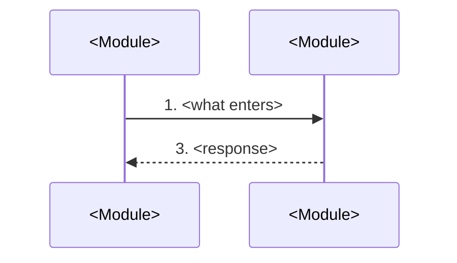

# spec.md

Two halves in one file, because they are one review: what must be true, then, when it applies, what is being built. The Developer builds from it with none of this run's context, and the people reviewing its pull request check the code against it.

## Before writing

- Read the project's recorded decisions (brain notes, the repositories' ADRs or decision logs). Each constrains the spec ([decisions.md](decisions.md)).
- Read the card whole. A design, mock-up or document linked from it binds unless the card calls it inspiration: link it under `## Sources`; a departure from it is a question, never a quiet change.
- When the card names something the system does not have (a field, an endpoint, a screen), say so: amend it in `Assumptions` when the code settles the intent, or ask. A spec that quietly builds the right thing leaves the card wrong for the next reader.

# What must be true

## Problem

Present tense, no solution inside it: what is true today that should not be, who pays, what it costs. "There is no CSV export" is the absence of an answer; "finance re-types every order of the month into a spreadsheet to reconcile it" is a problem someone can disagree with. Copy the evidence the card gives, or say it gives none.

Close with one line: what is different for a user when this ships. That line is the goal the criteria are held against.

## Walk the surfaces

Each kind of surface carries the same decisions every time. Walk the row for every surface the card exposes; each item becomes a criterion, an existing behaviour you name, or a question. The walk is not written into the spec.

| Surface | The decisions it always has |
|---|---|
| a screen or view | empty, loading, error and unauthorised states; order of content; the widths it must work at; what a long list or wide table does; what a destructive action confirms; what each control does: who acts, which control, what shows afterwards |
| an API or webhook | response shape, error shape with its codes, who may call it and what the rest get, versioning, rate limit behaviour |
| a command or scheduled job | output, each flag and its default, exit codes, what it does when it fails halfway, retries and duplicates |
| a file or export | format, encoding, columns and their order, size limit, what an empty result produces |
| stored data | what happens to existing rows, who reads them today |

The two that hide best: the error shape (decided by whoever writes the first handler) and the empty state (invisible until a new account opens the page). For Medium and up, also sweep input bounds, partial failure, permissions and concurrency; each is a criterion or nothing to decide, never filler.

## Criteria in EARS

| Pattern | Template | Use for |
|---|---|---|
| Ubiquitous | The [system] SHALL [response] | always-on invariants |
| Event-driven | WHEN [trigger] THEN the [system] SHALL [response] | a response to a discrete trigger |
| State-driven | WHILE [state] the [system] SHALL [response] | behaviour that holds during a state |
| Optional-feature | WHERE [feature is present] the [system] SHALL [response] | behaviour behind a flag |
| Unwanted-behaviour | IF [condition] THEN the [system] SHALL [response] | errors, invalid input, timeouts |
| Complex | WHILE [state], WHEN [trigger] the [system] SHALL [response] | combinations |

- **One requirement per criterion**, numbered `AC1`..`ACn` across the whole spec, never restarting per slice. Tasks and checks cite these ids.
- **A concrete value**: a status code, a field, a bound, a label. Never "quickly", "properly" or "gracefully". Edge cases are criteria, usually IF/THEN.
- **Slices, not layers.** Group criteria under `### S<n>: <outcome> (P1|P2)`: one outcome someone can watch. Preparation that proves nothing alone (a column, a client with no caller) is a task, not a slice. Priority orders the work; it never lowers the bar.
- **A control owes a gesture**: every control the feature adds gets a criterion naming who acts, which control, and what shows afterwards. Name the use as it really happens: editing what exists, not only creating.
- **A screen with no design gets outcomes, not layout.** Say what a user can see and do, never where things sit; layout is the builder's, held to the design system.
- **A backend criterion is a rule with examples under it**, one of them the strong case: the boundary, or the input where an implementation fitted to the obvious sample breaks.
- **One run must settle it.** A percentile, an average or an uptime is a service target, not a criterion: keep the behaviour, drop the target to `Out of scope` or observability.
- **A guarantee that something will not happen needs a mechanism** (a unique constraint, an idempotency key): name it, make it a `Landing` door, or ask.
- A criterion you cannot imagine a test for is not ready.

```markdown
- **AC2** IF the requested range is longer than 31 days THEN `GET /api/orders/export` SHALL respond 422 with `{"error":"range_too_long"}`
  - 31 days -> 200; 32 days -> 422; `from` after `to` -> 422 `invalid_range`
```

# What is being built

Write it when the path crosses more than one module, adds a route or contract, or touches stored data; always for Large and Complex. A Small spec skips it. No component catalogue, columns or types here: those are reversible and settled in the diff, or in `design.md`.

**Shape.** One sentence on what this reuses instead of duplicating; one on where the rules that change an outcome run, in a layer the repository's tests reach.

**The path.** One numbered line per hop: what enters, which module it crosses, what it hands on, what persists or goes out. Mark each module `(exists)` (it does today, verified in the code), `(new)` (placement is the builder's) or `(door <n>)` (a `Landing` row creates it). `single module - <name>` is complete.

**The drawing.** Draw the same path in mermaid: a `sequenceDiagram` for a request and its answer, a `flowchart` when it branches, fans out or hands off to a queue or job. Number each arrow with its line in the list and name the same modules in both.

**The data.** An `erDiagram` of the entities this reads or writes and how they relate (no attribute blocks), then `New: <entities and relations this adds>`. `New: nothing - read only` and `Data: none - <why>` are complete. Only when something moves through states: a `stateDiagram-v2` with each transition and its trigger.

**Changes underneath.** A table of what exists and changes: a domain term that changes meaning (and who branches on it today), stored data (backfill, migrate on read, or nothing), and each reader that will see the new data. Each reader named gets a criterion or an `Out of scope` row.

**Surface.** Only a route, event or file this adds or whose signature changes: what goes in, what comes out, statuses including what a caller who may not call gets (401, 403, 404 or a redirect), and who may call it. `None - nothing consumed outside` is complete.

**Landing.** The one-way doors: a persisted schema, a contract someone consumes, a new dependency, a backfill, a pattern the codebase does not have yet. Each row gives the literal shape the next person copies, the alternative rejected with the property that disqualified it, and its ADR ([decisions.md](decisions.md)). `None - <why nothing here is one-way>` is complete.

# The rest

- **Out of scope**: each capability someone might expect that this card does not build, and each reader of changed data left as is, with the reason.
- **Assumptions**: your default for what is not a gray area (the code settles it, or there is one defensible answer). `Confirmed? n` is yours, for the people reviewing the code to see; `y` only with its source (`card: Q2 b`). A gray area is never a row here: it is a question.
- **Open questions**: usually `None`. A gray area that blocks the documents is asked before they are written; this section holds a question raised later (on a revision, or one that only blocks go-live), one line each, numbered as where it was asked, with what it blocks ([questions.md](questions.md)).

## design.md (Large, Complex)

The depth `spec.md` leaves out, for the builder: how the parts fit, not what must be true. Sections: `## Architecture` (a mermaid drawing and a paragraph; for Complex, the 2-3 approaches weighed and the one chosen), `## Code reuse` (`| Existing | Location | How it is used |`), `## Components` (purpose, location, interfaces, what it reuses, per component), `## Data` (the models this adds or changes, and their relations), `## Error handling` (`| Scenario | Handling | What the user sees |`), `## Risks` (`| Concern | Location | Impact | Mitigation |`, from what you saw reading the code; `None found` is valid). It never restates criteria; it cites them by id.

## Template: `spec/spec.md`

`````markdown
# <CARD>: <Feature>

## Problem

<Present tense, no solution inside it: what is true today, who pays, what it costs. The evidence the card gives, or a note that it gives none.>

<What is different for a user when this ships.>

## Criteria

### S1: <the outcome someone can watch> (P1)

- **AC1** WHEN <who> <gesture> THEN the system SHALL <observable outcome with the concrete value>
- **AC2** IF <undesired condition> THEN the <system> SHALL <response with the value>
  - <example> -> <result>; <the strong case> -> <result>

## Shape

<Only when What is being built applies. One sentence: what this reuses. One sentence: where the rules run.>

1. <what enters> -> `<Module>` (exists) - <what it decides, what it hands on>
2. `<Module>` (new) - <what it does>, persists `<Entity>` (door 1)
3. out: `<response>`



```mermaid
erDiagram
    <Entity> ||--o{ <Entity> : "<verb>"
```

New: <entities and relations this adds, or `nothing - read only`>.

**Changes underneath**

| Front | What changes |
|---|---|
| domain | `<Name>` meant <x>, now means <y> - <who branches on it today> |
| stored data | <backfill now / migrate on read / nothing to migrate> |
| readers | <screen or job that shows the new data> |

## Surface

| Route | In | Out | Status | Who |
|---|---|---|---|---|
| `<METHOD> /<path>` | `<field>` | `<field>` | `<code>`, `<denied code>` | <who may call it, and what the rest get> |

## Landing

| One-way door | Literal shape | Alternative rejected | ADR |
|---|---|---|---|
| <what> | <the literal a reader copies> | <the option, and the property that disqualified it> | [ADR-NN](ADR-NN-<slug>.md) |

## Out of scope

| Excluded | Why |
|---|---|
| <capability> | <reason> |

## Assumptions

| Assumption | Chosen default | Rationale | Confirmed? |
|---|---|---|---|
| <what was not stated> | <what will be built> | <why: the code at `<path>`, or `card: Q1 a`> | y/n |

## Open questions

- Q3 - <the question in one line> - blocks AC5
<Or:> None

## Sources

- Card <CARD> - <what it settles>
- <linked design or document> - binding | non-binding (the card's words) - <what it settles>
`````

A Small spec drops `Shape`, `Surface` and `Landing`, and ends with `## Tasks` and `## Checks` ([tasks.md](tasks.md)).
